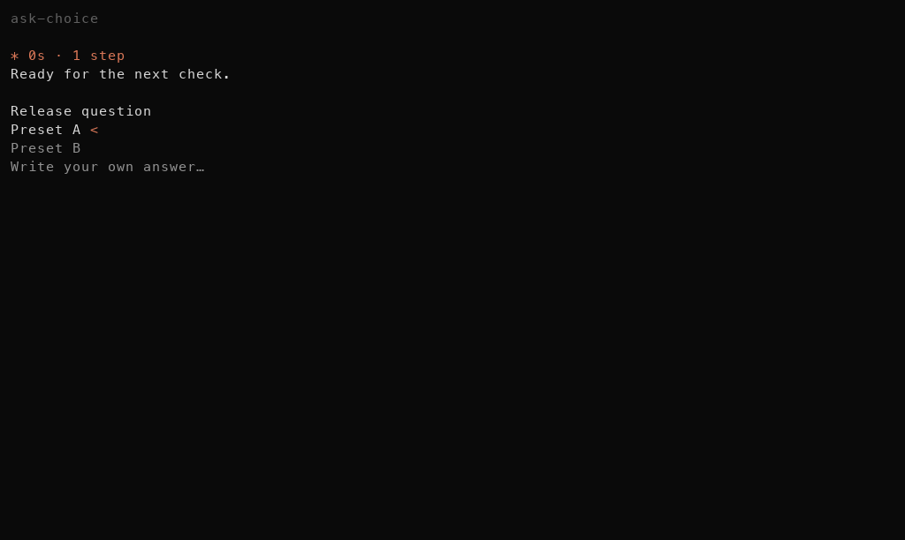
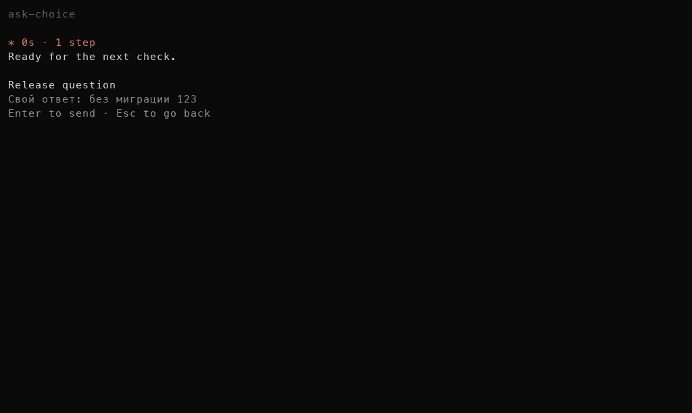
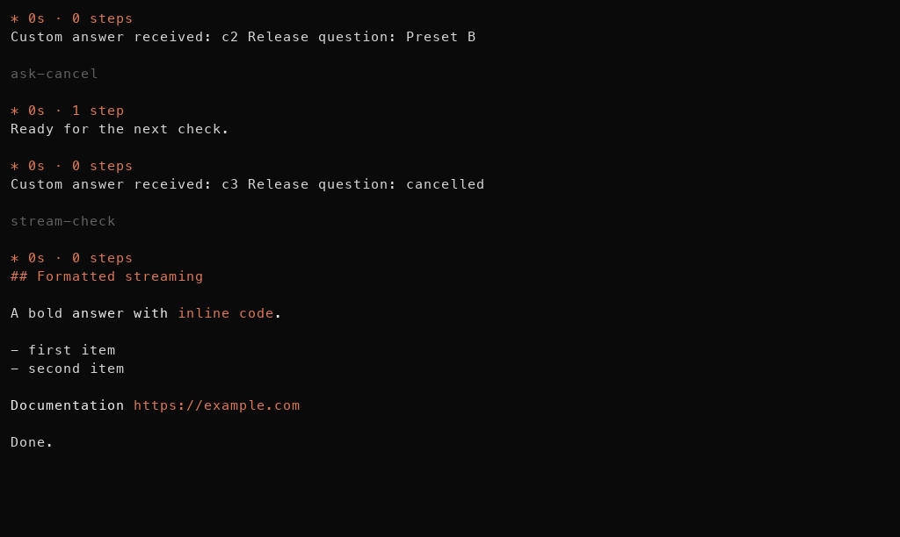
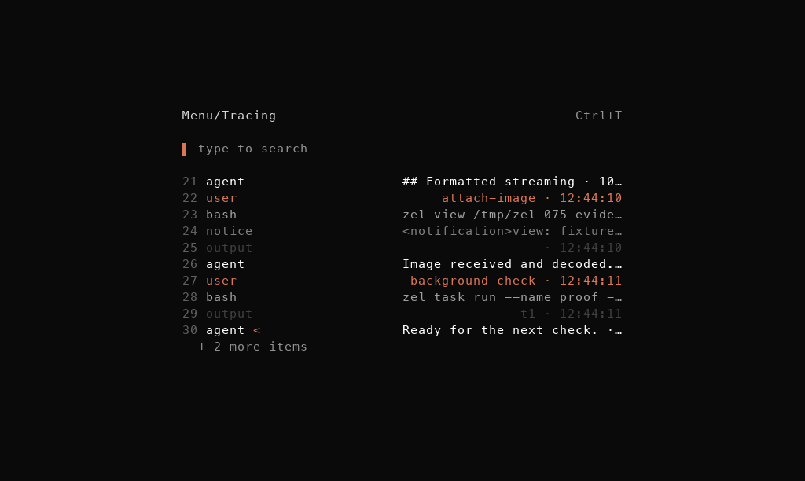
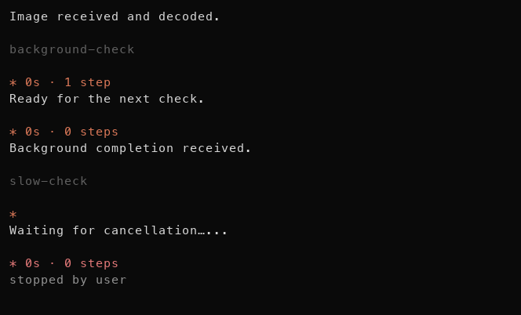
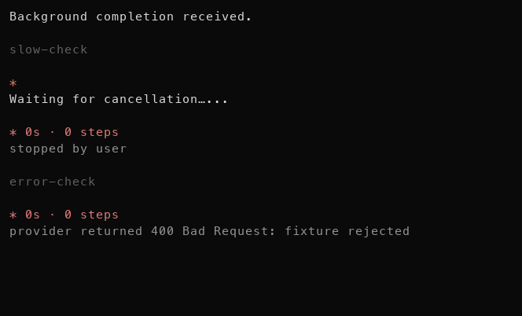

# Zel 0.7.5

Performance, simpler internals, and custom choice answers. Implemented from the
[approved plan](PLAN-0.7.5.md), using the [audit](AUDIT-2026-11-16.md) as a baseline.

## User-visible changes

- Every choice card offers **Write your own answer…**. Enter sends non-empty text;
  Esc returns to the options while keeping the custom draft. Preset shortcuts,
  cancellation, queued questions, and the normal composer draft are preserved.
- Tracing displays complete generated commands, not intermediate argument
  fragments. Tool execution, cancellation and steering are unchanged.
- New image previews are stored as private files, not base64 in retained history.
  Preview bytes are materialized only for outgoing requests that need them.
- Old and mixed-format chats remain readable. **No migration** or bulk rewriting
  of existing history. Existing embedded images may retain their original memory
  cost; file-backed storage applies to newly added images.
- Assistant text remains formatted while streaming. Stable blocks and file-path
  checks are reused; unnecessary redraw work is skipped.

## Internal improvements

- Cached immutable history projections, token estimates, validation, summaries,
  compaction results and event-log snapshots.
- Incremental save preparation and no-change metadata-write avoidance, with
  retry tests for failed writes.
- Incremental chat row-index updates; retained chat render caches when hidden
  trace copies are released; lazy allocation of the custom choice editor.
- Removed obsolete shell execution framework, unused model cache, old task
  implementations, no-op code and unused display helpers. Task tails use bounded
  suffix reads. Useful tests now target production paths.
- Separated provider stream handling, history projections, attachment files,
  controller transitions and UI chat-state ownership into cohesive blocks.
- Slow lifecycle/configuration work no longer holds the controller mutex.
  Reservations serialize changes and defer queued inputs until settings settle.
- Idle and asynchronous hooks are cancelled and joined before session resource
  release. No Rex helper or local hook-configuration changes.
- Explicit production import-boundary tests and corrected architecture docs.

This is not a rewrite. The small agent loop, provider normalization, process
cleanup, output bounds, event spool, durability and native selection behavior
remain. Production source grew modestly overall because file-backed attachments
and custom input require new behavior; obsolete-code deletion is not presented
as a net reduction of the whole application.

## Local measurements

Apple M1 Pro, darwin/arm64, Go 1.27.4. Generated fixtures, 300 ms benchmark budget,
2 runs. Baseline is `bb73d4d`; the same benchmark bodies were applied to a separate
baseline source copy. Idle history was fully warmed in both versions. Values are
rounded local observations, not performance guarantees or provider/network timings.

| Workload | 0.7.4 baseline | 0.7.5 | Result |
| --- | ---: | ---: | --- |
| Streaming formatted Markdown, ~16 KiB | ~2.80 ms; 2.04 MB allocated/frame | ~0.63 ms; 0.66 MB/frame | ~4.4x faster, ~68% less allocation |
| Streaming formatted Markdown, ~60 KiB | ~10.4 ms; 7.34 MB/frame | ~2.28 ms; 2.24 MB/frame | ~4.6x faster, ~69% less allocation |
| Trace snapshot, 5,000 unchanged events | ~0.73 ms; 1.96 MB | ~0.16 ms; 0.58 MB | ~4.6x faster, ~70% less allocation |
| Unchanged save, 10,000 metadata-bearing items | several ms; 1.69 MB | ~7.5 microseconds; ~2 KB | avoids full-history preparation and rewriting |
| Repeated fallback context count, 16 MiB image fixture | ~0.5 seconds; ~17 MB/call | ~0.86 microseconds after cache fill | historic image payloads are no longer rescanned |
| Warmed idle refresh, 10,000 entries | ~95 microseconds | ~97 microseconds | essentially unchanged; no false claim of a dramatic idle improvement |

Allocation totals are **not retained RAM**. The cached context benchmark includes
one initial cache-fill pass amortized across repetitions; first-use work still
exists. Removing partial command previews removes that work entirely rather than
comparing a different preview algorithm. The audit's ~145 MB temporary allocation
reproduction for a ~16 KiB fragmented command no longer represents a UI code path.

Raw measurements: [baseline](releases/0.7.5/before-bench.log) and
[after](releases/0.7.5/after-bench.log).

## Verification and visual evidence

- `make test`: formatting, vet, all package tests with `-race`.
- Core/TUI/shell/store race tests repeated 3 times.
- Native binaries cross-built for macOS and Linux, arm64 and amd64.
- Both provider protocols exercised with file-backed images, fragmented escaped
  tool arguments, complete-command delivery and real shell execution.
- Real compiled 0.7.5 TUI driven through a pseudo-terminal against a deterministic
  local HTTP/SSE fixture, not a paid/live model or a user's actual session.
- Manual flow covered custom answers, Esc/back with draft retention, numeric
  preset selection, choice cancellation, formatted streaming, images, background
  task notifications, tracing, resize, Ctrl+D, provider errors, recovery, clean
  quit, new-format resume, legacy resume without migration, and missing previews.

[Manual output](releases/0.7.5/manual.log) ·
[Check output](releases/0.7.5/final-checks.log) ·
[Repeated race output](releases/0.7.5/race-repeat.log) ·
[Platform builds](releases/0.7.5/platform-builds.log) ·
[Protocol coverage](releases/0.7.5/protocol-tests.log).

The captures below are actual TUI output rendered from the recorded PTY stream
using a terminal emulator with SU/SD scrolling support. They are not screenshots
of the macOS desktop. The [verification driver](releases/0.7.5/verify-terminal.py)
uses optional `pyte`/`Pillow` tooling in an isolated Python environment; these are
not Zel runtime dependencies. It expects the built binary at
`/tmp/zel-075-evidence/zel` and writes only isolated fixture sessions/evidence.
It now waits for terminal interactive mode before sending input: an earlier
run launched during concurrent cross-builds sent input before terminal setup
and was discarded as a harness startup race. Final captures come from the
successful guarded run.

### Choice options and custom input

### Formatted answer and complete-command trace

### Cancellation and provider-error handling

## Compatibility and limitations

- Copy the session attachment folder with history. Older Zel binaries cannot
  understand new file references; backward reading by 0.7.5 is supported, not
  backward reading of new data by 0.7.4. No migration was performed.
- Missing/corrupt references stop the affected request explicitly. Already
  compacted-away images need not exist for an outgoing request.
- File staging precedes history commits. Failed staging does not commit a broken
  history reference; failed metadata writes remain retryable.
- This does not claim to explain every byte of previously observed live Zel RAM,
  guarantee a fixed memory footprint, or improve model/network response time.
- Rex integration, a general storage rewrite, and further supported-feature
  removals remain outside scope.

## Publication

Published [v0.7.5](https://github.com/ethanhamilthon/zel/releases/tag/v0.7.5)
from commit `4fa798762200ab12a67b08a940e2dd9785985442`.

- [Main CI](https://github.com/ethanhamilthon/zel/actions/runs/43826327836): success on macOS and Linux.
- [Tag checks and release](https://github.com/ethanhamilthon/zel/actions/runs/43826386790): all three jobs succeeded.
- Published macOS/Linux archives for arm64/amd64 and `checksums.txt`.
- Downloaded assets and checksum/native-version verification are recorded in
  [artifact checks](releases/0.7.5/published-artifacts.log).

These are remote workflow results, not inferred from local tests. The release
tag is immutable; this publication record is a documentation-only follow-up.
