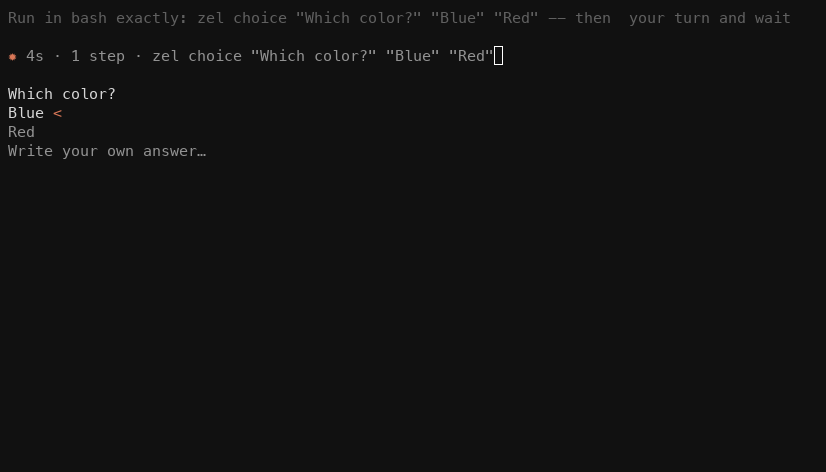
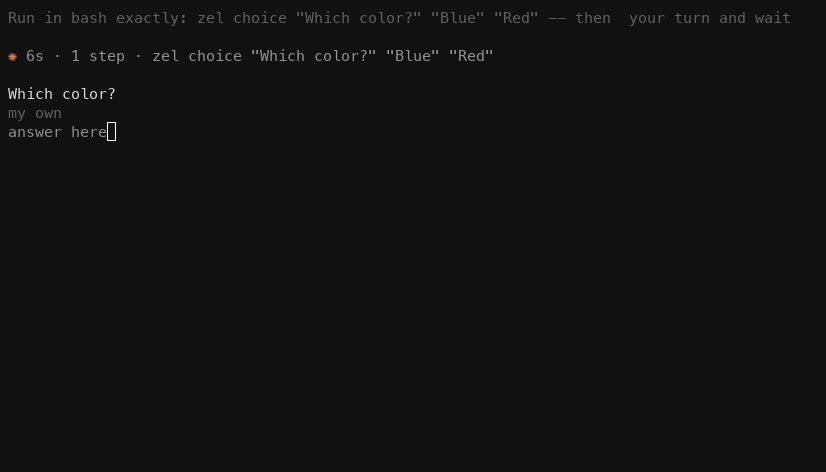
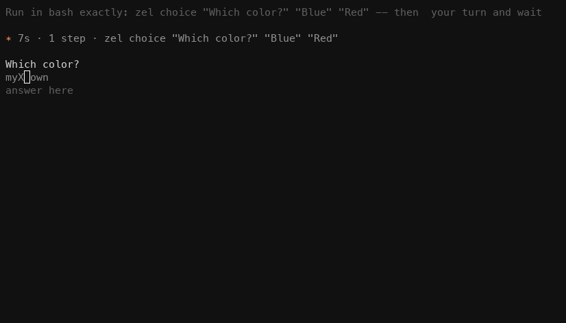
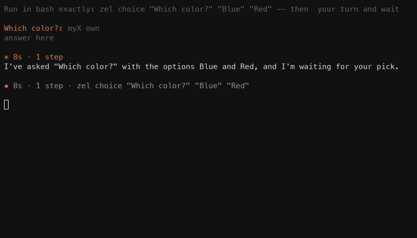
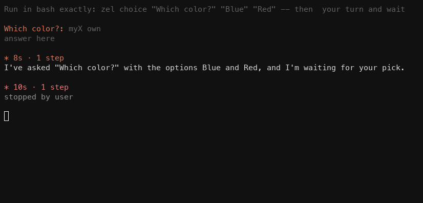
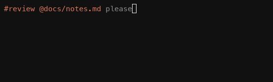
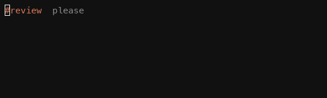
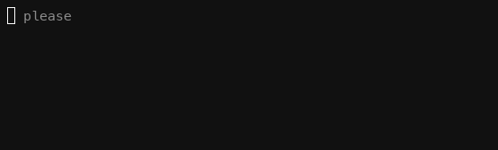
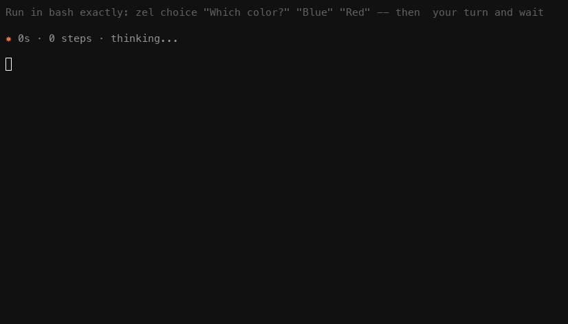

# Zel 0.7.6

Choice answers in the chat, a composer-grade custom answer, steadier screen
updates, and completed tokens in the composer.

## User-visible changes

- An answered choice stays in the chat as `question: answer`: the question in
  the accent color, the answer in the user message color. Answers are saved in
  the session's `choices.jsonl` and come back on resume.
- The custom answer edits like the composer: it grows with its lines
  (Alt+Enter, Shift+Enter or Ctrl+J insert a newline), a click moves the cursor,
  and the Enter/Esc hints are gone. Mouse reporting is on only while the custom
  answer is open, so terminal selection works everywhere else.
- A sent message shows in the chat the moment it leaves the composer; the
  agent's copy takes its place without a blink. Queued (steering) messages do
  the same when the agent takes them.
- The working indicator stays for the whole turn, below streaming answers too.
- A `#name` or `@path` picked from a completion list is one accent-colored
  token: the cursor jumps over it, and one Backspace or Delete removes it whole.

## Compatibility

- Old chats open unchanged; they simply have no recorded answers.
- `zel choice` notifications to the agent keep the same format.

## Verification

- `make test` (gofmt, vet, tests with `-race`) passes; new tests cover answer
  records and resume, the custom editor (multi-line, no hints, click, mouse
  release), the sent message staying visible, the indicator during answers, and
  token spans, cursor snapping, whole-token deletion and coloring.
- Manual run in a pseudo-terminal against a real model:

