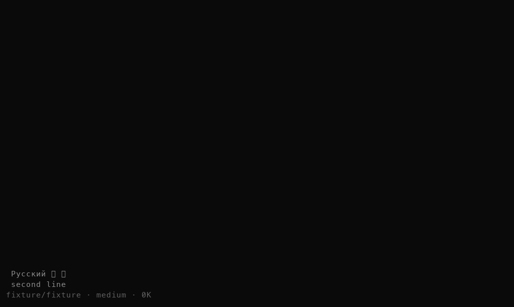
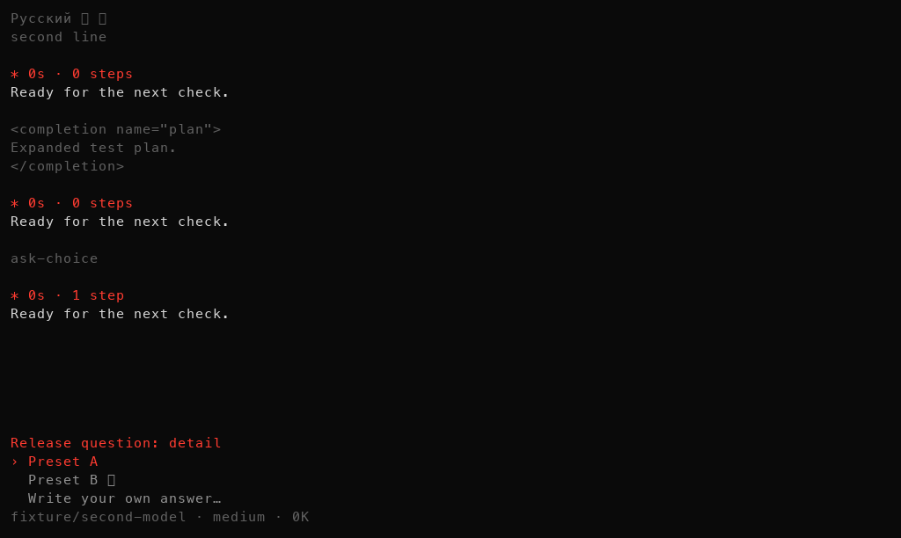
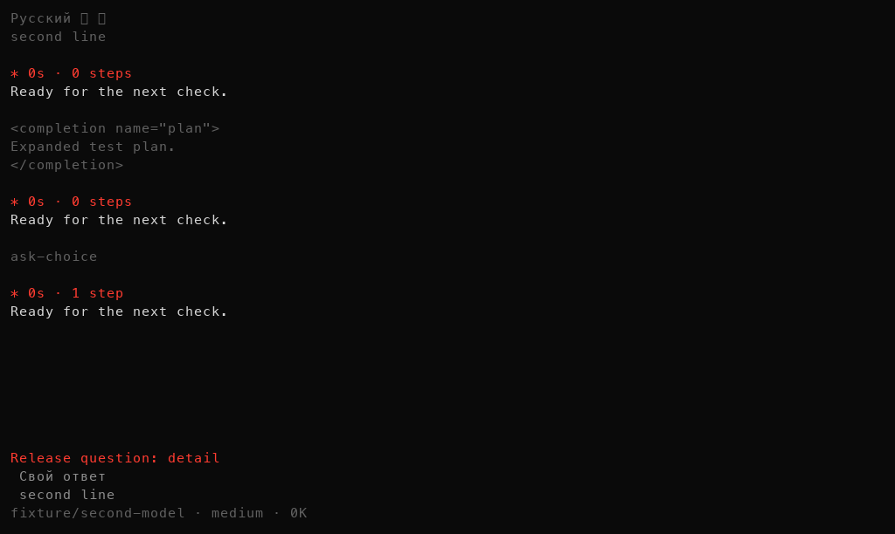
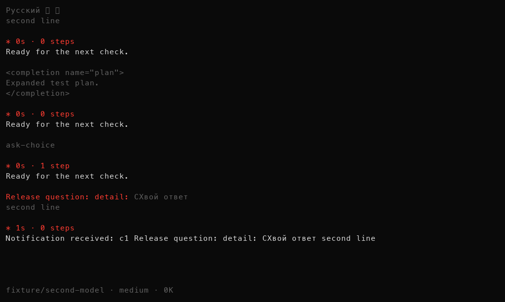
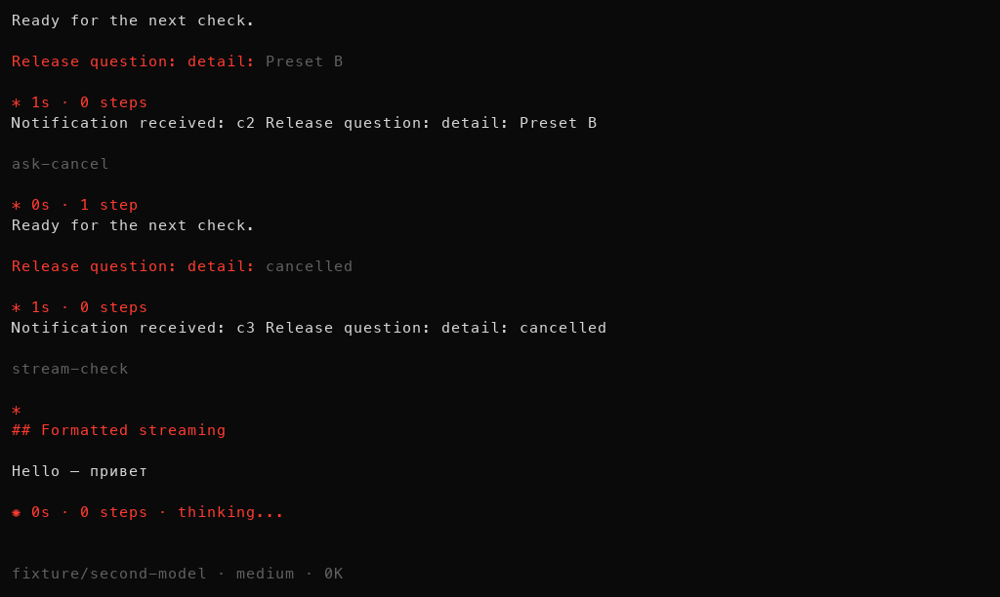
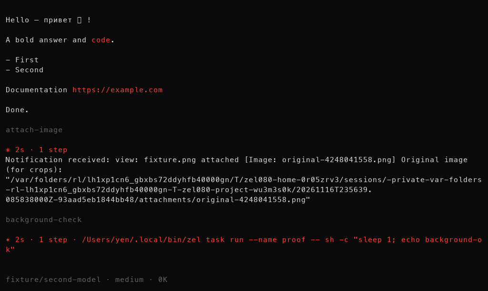
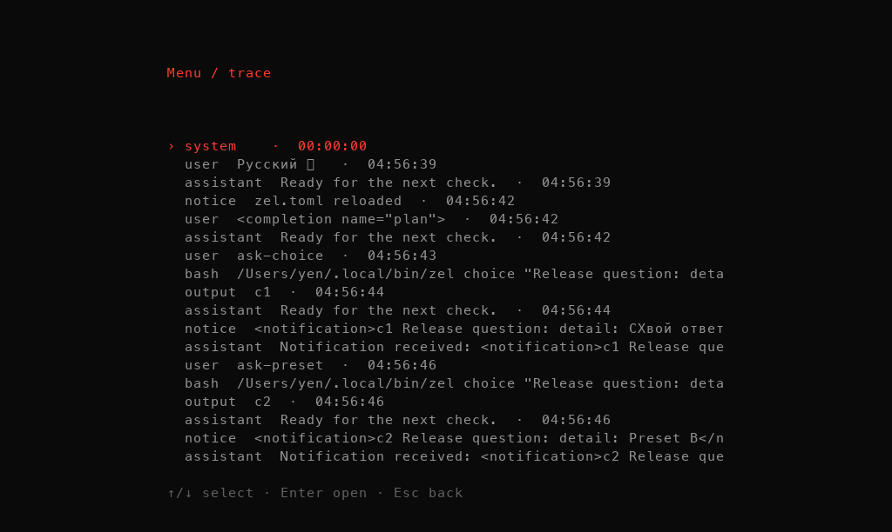
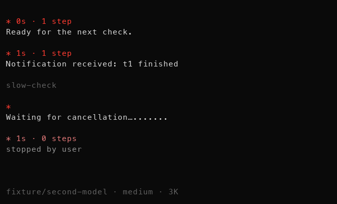

# Zel 0.8.0 — tcell

The terminal interface now runs on tcell. Bubble Tea, Bubbles and the old
custom terminal renderer/cursor interception are removed, not kept as a second
frontend. The runtime, provider requests, session format and helper commands
are unchanged.

## Interface

- One multiline editor serves the composer, custom choice answers, search and
  settings forms. Cursor movement and deletion respect Unicode graphemes;
  completed prompt/file tokens keep their accent color and atomic editing.
- One searchable list serves menus and completions. Models/efforts, sessions,
  rename, tracing, info, provider onboarding and settings remain available.
- Streaming answers keep their working indicator. Background task rows, queued
  input, editing to withdraw a queued draft and recall remain available.
- Mouse clicks position the input cursor. Dragging chat text selects it and
  copies on release; Ctrl+C copies the selection again. Shift+drag uses the
  terminal's own selection. Ctrl+click opens a rendered hyperlink.
- tcell handles paste, enhanced keyboard input, resizing, the cursor and screen
  updates. Alt+Enter, Shift+Enter or Ctrl+J inserts a newline. Ctrl+M/Ctrl+I need
  a terminal that distinguishes them from Enter/Tab; use Ctrl+K otherwise.
- Glamour still formats Markdown; it does not control the terminal. Formatting
  is decoded into styled text runs. Record caches and a short formatting budget
  keep old answers from blocking input while a large chat is laid out.

This release changes the terminal implementation, not the product's feature
scope. Further cuts to menus/configuration are a separate decision.

The frontend is about 3.5k production Go lines, down from 5,977 (about 42%
less). The whole project is about 14k production Go lines, down from 16,463.
Tests and release evidence are counted separately; deleting obsolete framework
tests is not included in those savings.

## Verification

- `make test`: gofmt, vet and all tests with `-race`.
- Build matrix: macOS/Linux, arm64/amd64, CGO disabled.
- Focused unit tests cover grapheme editing, visual wrapping, cursor placement,
  token deletion, style/hyperlink boundaries, bounded ordered events, stale
  results, choices, draft handling and tiny screens.
- `releases/0.8.0/verify-terminal.py` drives the actual binary through a PTY
  against a deterministic local streaming provider, using an isolated home.
  It covers multiline bracketed paste, model/effort selection, completions,
  custom and preset questions, clicking inside a custom answer, image bytes,
  tasks, a child agent, tracing, resize, queued draft withdrawal, cancellation,
  provider errors/recovery, settings persistence, clean quit and resume.
- Separately exercised in Rex: Ctrl+M, Shift+Enter, Cyrillic and joined emoji;
  the provider received the original Unicode text and newline unchanged.

The PNG evidence below is reconstructed from captured terminal cells, not OS
screenshots. pyte and the evidence font do not render joined emoji fully; the
Rex text capture and provider payload check verify their actual preservation.

