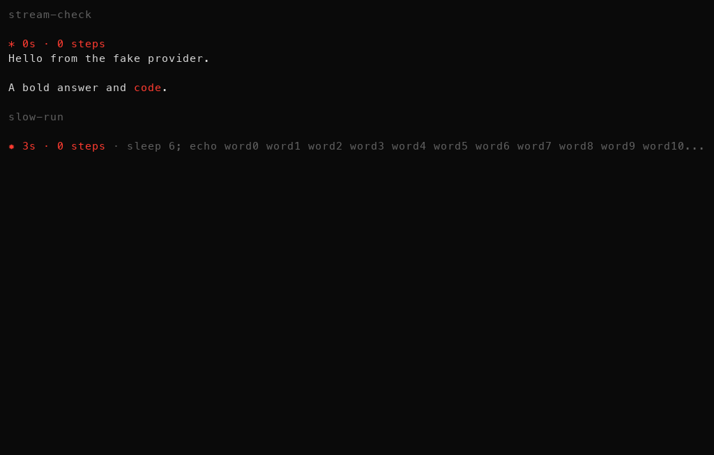
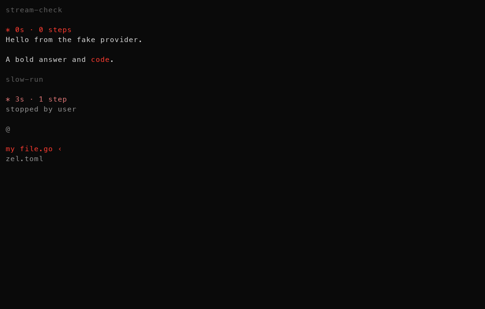
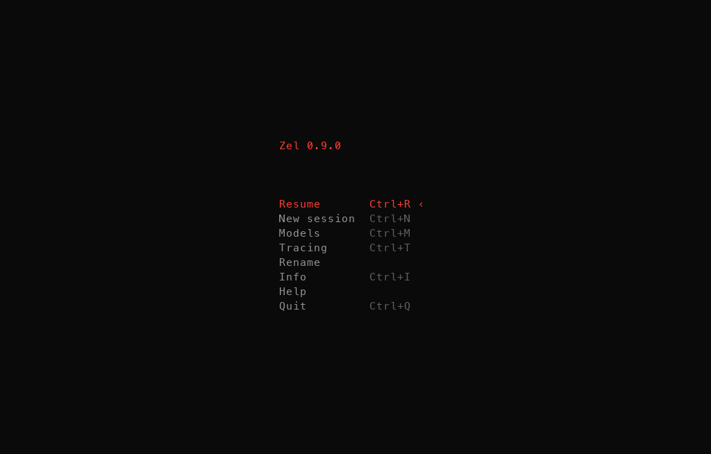
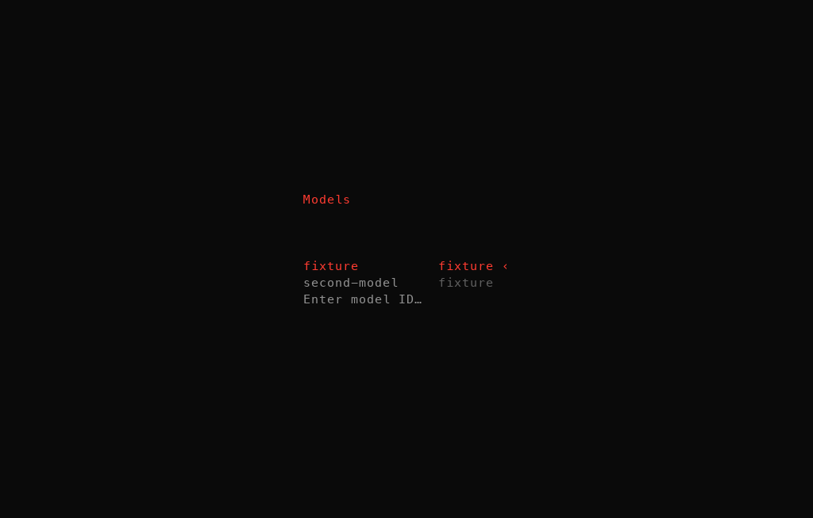
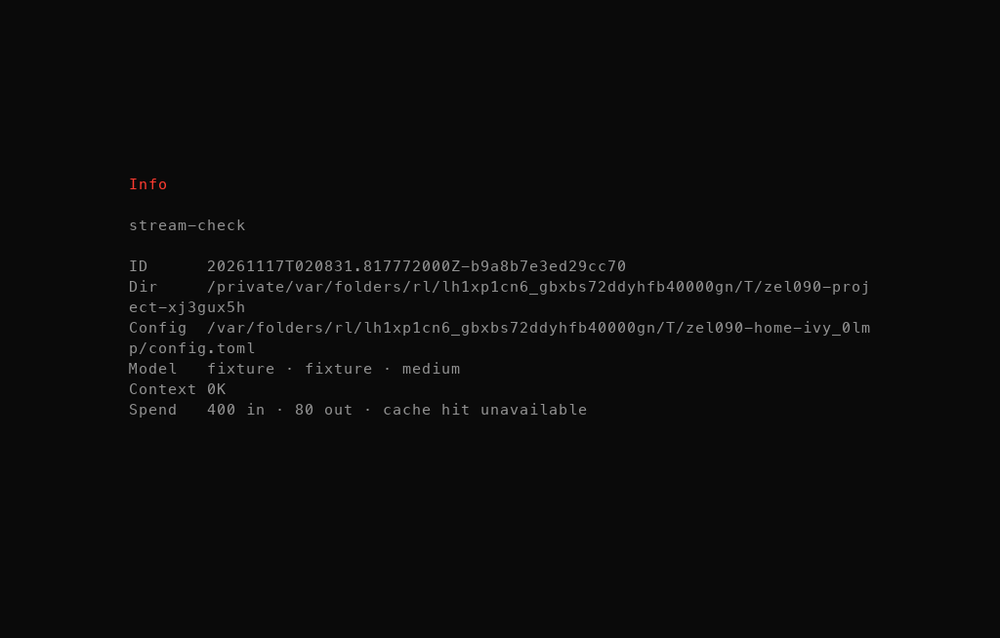
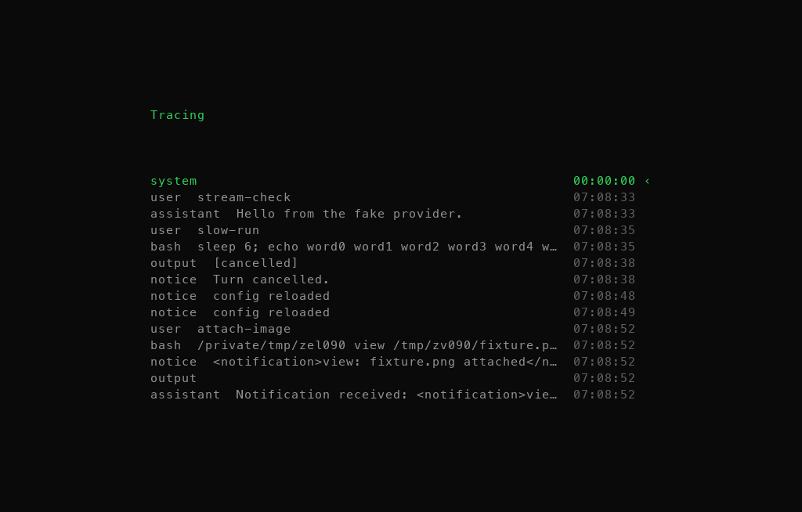
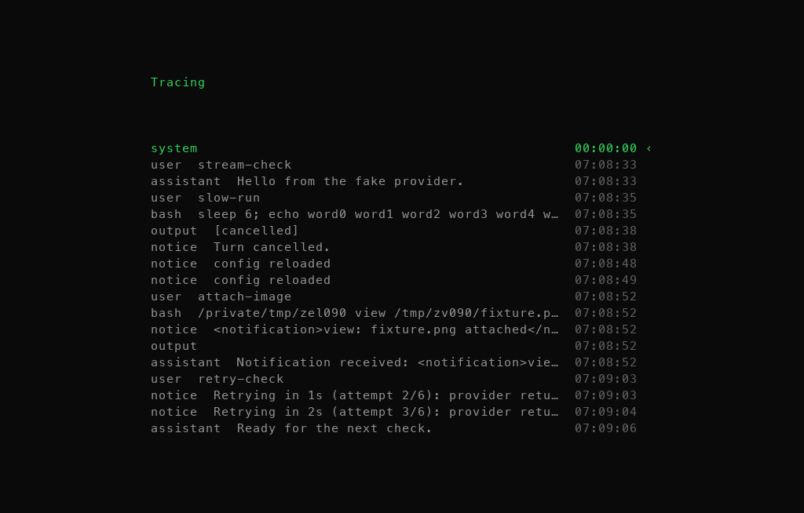

# Zel 0.9.0 — one config, less code

A cleaning release. It has no migration and is not compatible with 0.8:
`scripts/update.sh` moves `~/.zel` for you (see Update).

## Config and `~/.zel`

- One config: `~/.zel/config.toml` (was `zel.toml`). There is no per-folder
  `./zel.toml` and no layers or merging.
- `--config FILE` takes exactly one path and replaces the home config. A
  `zel -p` child uses the config of its parent (`ZEL_CONFIG` is one path;
  the `config_changed` hook gets `file`, not `files`).
- Everything Zel creates is in `~/.zel/.sessions/` (sessions and sockets). A
  new `~/.zel` holds a commented `config.toml` and a `.gitignore` with `.env`
  and `.sessions/`.
- Providers, Settings and onboarding are gone from the UI. The app only
  reads the config and follows its changes; the one thing it writes is
  `provider`/`model`/`effort` when you choose a model. Without a provider
  the TUI exits with an error.

## Images

- No image handling in the app: no paste, no attachments folder, no stored
  originals. `zel view IMG` is the only way; the preview lives in memory while
  the agent works.
- The saved history keeps `[an image was here]`. Older chats with images show
  the same placeholder.

## Interface

- Working indicator: the running command is dark gray, on one line, cut with
  `...`.
- The input has no left padding and one empty line above it (was two).
- Lists (completions, models, sessions, choice options, the menu) share one
  design: label column, a second column for hotkeys or dates, and `‹` on the
  right of the selected row, without left padding. A completion panel is
  separated from the input by one empty line.
- Menus, Info, Help, Tracing and forms are centered on both axes, without key
  hints.
- The mouse is not captured: the terminal selects text and opens links.
  Up/Down (single-line input) and PgUp/PgDn scroll the chat.

## Retry

- Six attempts with exponential backoff (1 s up to 30 s) and jitter.
- `Retry-After` as seconds or an HTTP date; a server that asks for more than
  two minutes, an empty quota, and 501/505 are not retried.
- A failure after the start of a response but before any content is retried
  too, as are provider-side stream failures (`server_error`, `overloaded`).

## Size

Production Go code went from 13,981 to 12,936 lines (about 1,050 less), even
with the stronger retry: the config layers, settings and provider menus,
onboarding, selection and mouse, clipboard and image storage are gone.

## Update

```sh
curl -fsSL https://raw.githubusercontent.com/ethanhamilthon/zel/main/scripts/update.sh | sh
```

It installs the release, renames `zel.toml` to `config.toml`, `sessions/` to
`.sessions/`, adds the `.gitignore` and tells you what to fix by hand (a
project `./zel.toml` moves into `config.toml`). `ZEL_CLEAN_ATTACHMENTS=1`
deletes the old image copies.

## Verification

- `make test`: gofmt, vet and all tests with `-race`.
- `releases/0.9.0/verify-terminal.py` drives the real binary through a PTY
  against a local fake provider and an isolated home (log:
  `releases/0.9.0/terminal-checks.log`). It checks: the exit without a
  provider and the default files, the composer paddings, the one-line dark
  gray working command, the completion panel, the centered two-column menu
  without hints, a model choice that changes only the model line, a config
  edit applied while running, no mouse capture, `zel view` with no stored
  image and a placeholder after a resume, retries after two 503 answers, and
  `--config` against a project `./zel.toml`.

The PNG files are renderings of the captured terminal cells, not OS
screenshots.









